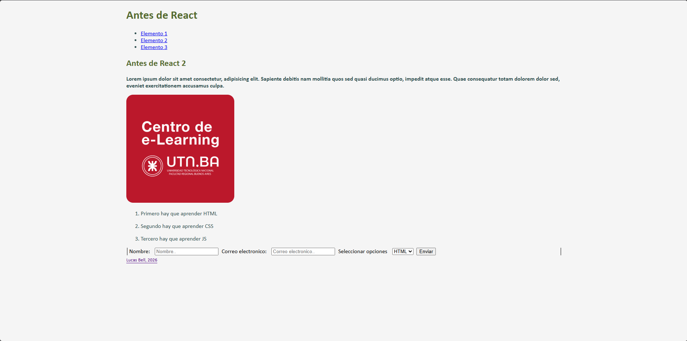

Descripcion:

En este proyecto se volco los primeros conocimientos que se adquirieron en la reciente clase virtual del curso de Programacion Web Full Stack. En este, se encuentra un form simple de 3 campos, un header, un article, y un footer.

Instalacion:

1- Para clonar este repositorio, hay que entrar al boton verde "Code", copiar la URL mediante HTTPS o el que prefieras

2- Ir a tu consola/terminal de preferencia 

3- Navegar hasta la carpeta deseada usando cd rutadelacarpeta 

4- Poner en la terminal/consola el siguiente comando: git clone https://github.com/lucasbell275/tarea_primer_clase.git

Vista previa de este proyecto:

Bibliografia:

https://www.w3schools.com/css/css_border.asp

https://www.w3schools.com/css/css_colors.asp

https://www.w3schools.com/css/css_margin.asp